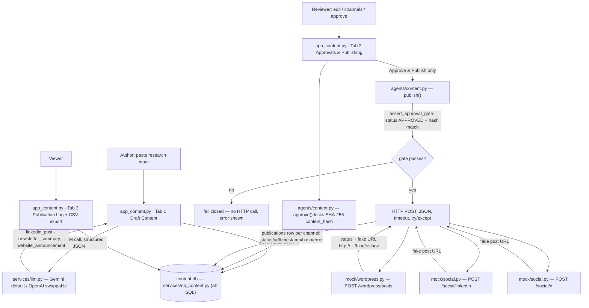

# Architecture — Part 2: AI Content Generation & Automated Publishing Agent

(All data used by this prototype is fictional; no confidential or personal data, and no real credentials are included.)

## 1. Scope

Part 2 turns **research project updates** (project description, project update,
findings summary, event announcement) into professional, channel-tailored
communication material, puts a **human reviewer in charge of an explicit
approval gate**, and only then **automatically publishes** to a local mock
publishing API, logging every attempt with status, timestamp, URL and version.

It lives in a **sibling repo to the Part 1 financial agent** (`ai-financial-assistant/`
≈ `AI-Powered Financial Management/`), shares the *contract* of the same
`services/llm.py` provider wrapper (Gemini default, OpenAI swappable via `.env`),
and keeps its own `content.db` so the two agents stay fully independent.

## 2. Architecture diagram



## 3. Why plain Python + a local mock API (not n8n/Zapier, not live social APIs)

| Alternative | Why not here |
|---|---|
| **n8n / Zapier** | Assessment environment has no accounts for external automation SaaS, and the requirement is to show *real code* executing: a gate, structured JSON, HTTP round-trips and error handling. Plain functions (`agents/content.py`, ~1 file) demonstrate that directly, with zero framework lock-in. |
| **Live WordPress / LinkedIn / X APIs** | No production site or developer credentials are available in the assessment, and the rules forbid using real social media credentials. |
| **Chosen: local mock HTTP services** | `mock/wordpress.py` and `mock/social.py` are **real, running FastAPI services**: the agent sends genuine `HTTP POST` requests with JSON payloads and timeouts, and receives genuine JSON responses (or error statuses), so everything observable in production is observable in the demo — payloads, latency, failure modes, retry/no-op behavior. |

The mocks are **one-for-one stand-ins**; the docstring of each mock states the
exact production integration it mirrors:

| Mock endpoint | Production integration |
|---|---|
| `POST /wordpress/posts` | WordPress REST API: `POST /wp-json/wp/v2/posts`, application-password Basic auth, returns `id` + `link` |
| `POST /social/linkedin` | LinkedIn API v2: `POST https://api.linkedin.com/v2/ugcPosts`, OAuth2 access token, returns an activity URN (mock returns a `urn:li:share`-shaped fake feed URL and enforces the ~3000-char limit like production) |
| `POST /social/x` | X API v2: `POST https://api.twitter.com/2/tweets`, OAuth2 token (used as the third round-trip target so *every* channel demonstrates a real HTTP hop; a real newsletter would use an email/newsletter service such as Mailchimp) |

Swapping production in later = add auth + real base URLs; payloads, gates,
logging and UI stay untouched.

## 4. The approval gate (mandatory, fail closed)

Implemented in `agents/content.py`:

1. **Explicit approval only:** `approve(content_id, channels)` is the *only*
   function that writes `status = APPROVED`, and it stamps:
   - `approved_at` (UTC timestamp),
   - `approved_content_hash` — `SHA-256` of the canonical JSON of the **current**
     three drafts (the approval “fingerprint”),
   - `selected_channels` (the checkbox selection at approval time).
2. **Publish precondition (`assert_approval_gate`)** — `publish()` calls it
   **first** and refuses (raises `ApprovalError`, records nothing) unless:
   - workflow status is `APPROVED` (or `PUBLISHED` with unchanged content for
     the idempotent re-publish case), **and**
   - `approved_at` / `approved_content_hash` exist, **and**
   - `SHA-256(current drafts) == approved_content_hash`.
   
   A row whose stored status was flipped back to `APPROVED` is still blocked by
   the hash check (tested in `tests/test_publish_gate.py::test_hash_mismatch_blocks_publish_even_if_status_says_approved`).
3. **Edit after approval → OUTDATED:** `save_edits()` persists reviewer edits and
   — if the row was `APPROVED`/`PUBLISHED` — resets status to `OUTDATED`. The row
   must be re-approved; re-approval computes a *new* hash, so publishing the
   edited content later produces **new publication rows (a new version)**.
4. **Idempotency:** re-publishing an approved row into the same channel with the
   same approved hash is a genuine **no-op** (no HTTP call, no duplicate log
   row). Only changed (freshly re-approved) content publishes again.
5. **Fail closed everywhere:** no approval record → no publish; select zero
   channels → approval refused; unknown channel → refused; empty draft → logged
   `FAILED` row, never silent success.

`tests/test_publish_gate.py` proves 1–4 (publication impossible before
approval; edit → blocked until re-approval; hash tampering blocked; republish
no-op) plus a live round-trip against the mock API.

## 5. Data model (`services/db_content.py`, all SQL here; auto-created)

- **content** — one row per input: `id, title, source_text, linkedin_post,
  newsletter_summary, website_announcement, status (DRAFT / PENDING_APPROVAL /
  APPROVED / PUBLISHED / REJECTED / OUTDATED), approved_at,
  approved_content_hash, selected_channels, created_at`
- **publications** — one row per *attempt* per channel: `id, content_id,
  channel, status (SUCCEEDED/FAILED), published_url, published_at,
  error_message, content_hash (= version marker)`

## 6. Error handling summary

| Failure | Where | Behavior |
|---|---|---|
| Empty source text | `generate_drafts` | `ContentError`, clear message in UI |
| LLM unreachable / provider error / no key | `services/llm.py` | `LLMError` with actionable message |
| Malformed / incomplete LLM JSON | `llm.chat_json`, `generate_drafts` | `LLMError` / `ContentError` with a preview of the bad output |
| Missing approval / hash mismatch | `assert_approval_gate` | `ApprovalError`, nothing published |
| Mock API down / HTTP 4xx-5xx / non-JSON body / missing URL | `_post_json` | per-channel `FAILED` publication row with the error, immediate red result in the UI |
| Over-limit text (e.g. >3000 chars LinkedIn) | mock validation | HTTP 422 → recorded `FAILED` (production-like) |
| Republish of unchanged content | `publish` | `ALREADY_PUBLISHED` shown, no duplicates |

## 7. Setup & run

```bash
cd ai-content-publishing
python3 -m venv .venv && source .venv/bin/activate
pip install -r requirements.txt
cp .env.example .env          # add a GEMINI_API_KEY (free: https://aistudio.google.com/apikey)

# 1) start the mock publishing API (real HTTP service)
python scripts/run_mock_api.py        # http://127.0.0.1:8001  (or let the Streamlit sidebar auto-start it)

# 2) run the app
streamlit run app_content.py

# 3) tests
pytest -q                              # approval-gate tests (+ live round-trip when mock is up)
```

## 8. 3-minute demo walkthrough (Part 2 share of the combined video)

1. **Tab 1** — "Load a fictional sample" → pick the *findings summary with
   numbers* → **Generate three drafts** → point out the three genuinely
   different versions and that `47 %`, `2.1 → 2.8`, `214`, dates are copied
   verbatim → **Save to content library**.
2. **Tab 2** — select the row (📝 DRAFT → optionally ⏳ Submit for review), edit
   the LinkedIn text slightly, uncheck a channel, **Save edits only** on an
   approved row to show 🔄 OUTDATED; try **Re-publish** → blocked (gate).
3. Then **Approve & Publish** → three green results with the mock URLs; open
   the `http://127.0.0.1:8001/blog/<slug>` URL — the "website" really serves it.
4. Edit an already-published row → status flips to 🔄 OUTDATED → publish
   blocked → **Approve & Publish** again → new version appears.
5. **Tab 3** — publication log with SUCCEEDED/FAILED rows, hashes/versions,
   timestamps, per-channel error messages → **Export CSV**.
6. Show `pytest -q` (8 passed) and `outputs/publication_log.csv`.

## 9. Evaluation criteria mapping

| Criterion | How Part 2 satisfies it | Files |
|---|---|---|
| **Functionality** | One input → three genuinely tailored drafts; statuses; filters; edit/approve/reject; publish; log; CSV | `agents/content.py`, `app_content.py`, `services/db_content.py` |
| **Automation & integration** | One structured-JSON LLM call; after approval, the *same agent code* makes real `HTTP POST` calls (JSON, timeout, try/except) to a live mock API and stores returned URLs automatically | `agents/content.py`, `services/llm.py`, `mock/wordpress.py`, `mock/social.py`, `scripts/run_mock_api.py` |
| **Approval + publishing flow** | Human gate is mandatory and code-enforced (status + SHA-256 content hash); edit-after-approval → OUTDATED → re-approve; idempotent republish | `agents/content.py` (`approve`, `assert_approval_gate`, `publish`, `save_edits`), `tests/test_publish_gate.py` |
| **Data validation & error handling** | Input validation, LLM JSON validation, per-channel publish failure capture (HTTP status/non-JSON/unreachable → FAILED rows + UI), 422 over-limit demo, no silent failures | `services/llm.py`, `agents/content.py`, `mock/social.py` |
| **Usability & docs** | One-click sample loading, 3 tabs, status badges, per-channel results, CSV export, demo script + architecture doc + README | `app_content.py`, `docs/architecture_content.md`, `README.md` |

## 10. Limitations & next steps

**Limitations**
- Mock endpoints have **no real social reach or real site** — URLs are fake;
  posts live in the mock server's memory until it restarts.
- No rich-media/image uploads to the "website" (text-only articles).
- **Single approver** and no role separation; one user acts as author & reviewer.
- No scheduling / delayed publishing (publish is immediate on approval).
- Newsletter goes to the mock `/social/x` endpoint so every channel has a real
  HTTP round-trip; a real deployment would use an email/newsletter service.
- The published article on the mock "website" is stored in memory only; a real
  WordPress would persist it in the CMS.

**Next steps, in priority order**
1. Swap mocks for real WordPress REST (`application passwords`) + LinkedIn
   (`ugcPosts`) behind the same interface — retrieval of credentials via env.
2. Multi-approver roles (author ≠ reviewer) with an audit trail.
3. Scheduled publication + "update/correct a published article" workflow.
4. Image generation/selection for the website + LinkedIn attachments.
5. Reader metrics fetch-back (views/likes) into the publications table.
